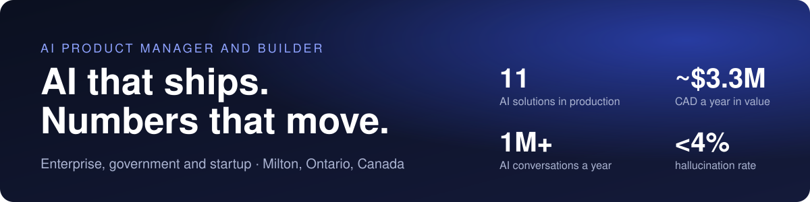

### Hi, I'm Zaigham 👋

I turn messy enterprise problems into AI products that run in production and pay for themselves. 10+ years across telecom, government and startups, now shipping agentic AI, LLM and RAG solutions with cross-functional teams of 25+.

**Proof, not promises**
- 🚀 **11 AI solutions** shipped to production in 5 years: virtual assistants, RAG search, agentic and document AI
- 💬 **1M+ AI conversations a year**, 80%+ contained, 8.5/10 CSAT
- 🎯 **92% task success** on a 200-case golden set, hallucination down from 15% to **under 4%**
- 💰 **~CAD 3.3M a year** in savings and client value, **30% lower cost per query** with LLM routing

### What I build

| Project | What it does |
|---|---|
| [**Portfolio and AI twin**](https://zee-ailabs.github.io) | 3D portfolio with an AI twin that answers recruiter questions around the clock |
| [**ModelFit**](https://zee-ailabs.github.io/ModelFit/) | Matches every AI use case to the right model on quality, speed and cost to serve |
| [**Enterprise AI Architecture Lab**](https://zee-ailabs.github.io/enterprise-ai-lab/) | Visual training program on AI foundations, virtual assistants, RAG and agentic AI |

### Toolkit
`OpenAI` `Anthropic Claude` `Azure OpenAI` `Amazon Bedrock` `Google Gemini` `Microsoft 365 Copilot` `Copilot Studio` `Claude Code` `Codex` `Lovable` `Azure` `AWS` `Google Cloud`

**Certified:** PMP · CBAP · SAFe POPM · SAFe Agilist · CSM · Lean Six Sigma Black Belt · AZ-900

### Let's talk

